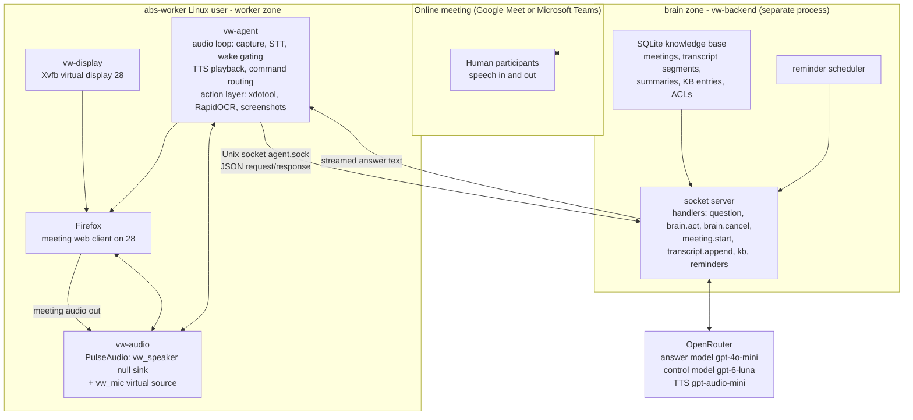
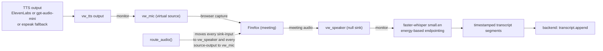
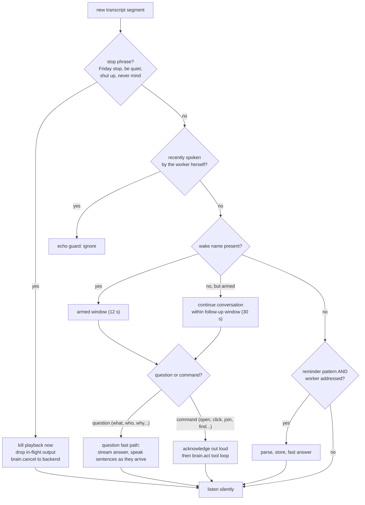
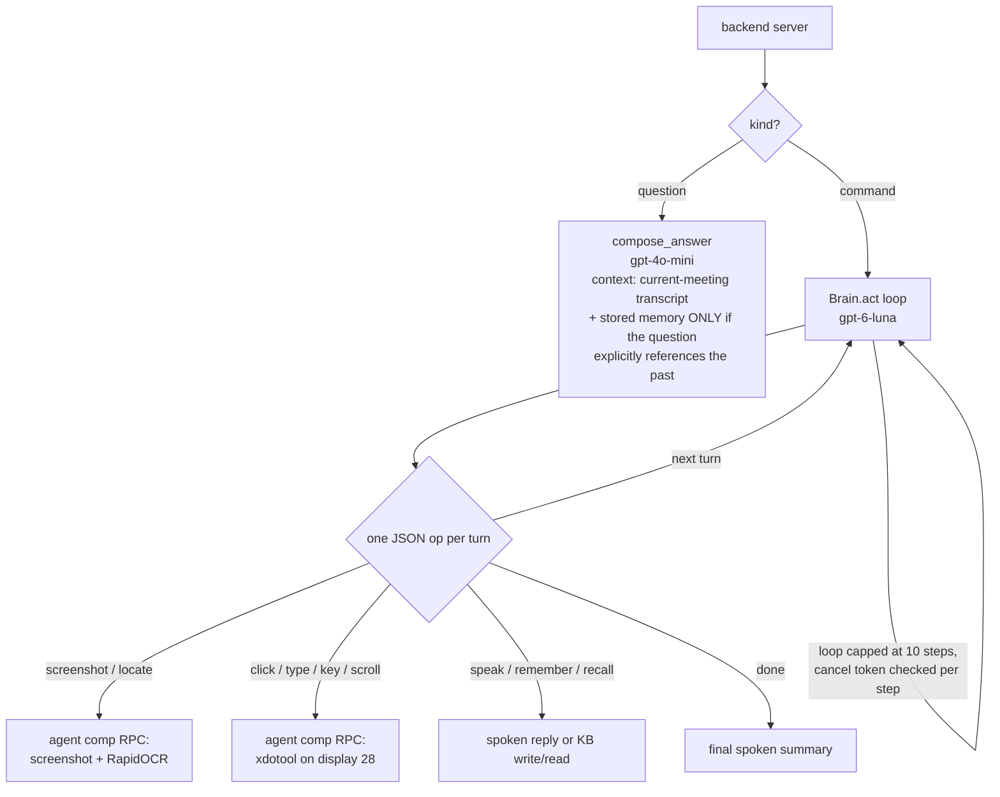
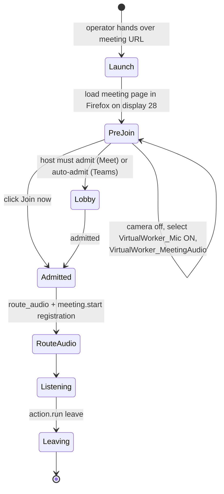
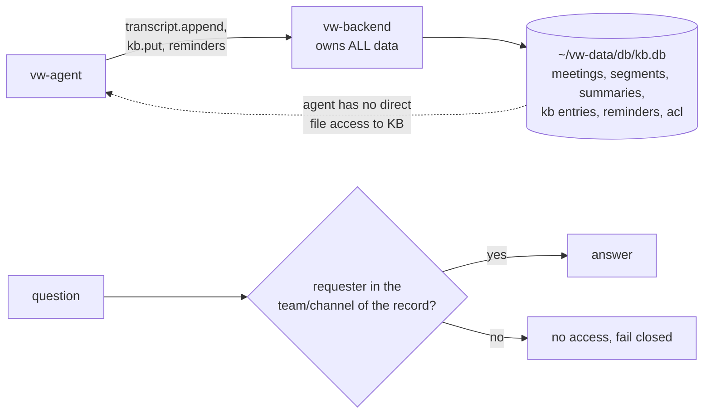

# Virtual Worker ("Friday") — Architecture

As-deployed architecture diagrams. The accompanying narrative lives in
[`design.md`](design.md); the PoC goals in [`requirements.md`](requirements.md).

---

## 1. System overview

Two trust zones. The **worker zone** runs as the dedicated `abs-worker` Linux
user under its own systemd user instance: it owns the display, the audio
stack, and the browser. The **brain zone** (backend) is a separate process on
the same host that owns all persistent data. The only bridge between the two
is one Unix domain socket, `~/vw-data/run/agent.sock`, which the backend also
exposes to the operator's CLI.



The agent never talks to the LLM directly and never touches the database:
every model call, memory read/write, and ACL check goes through the backend.

---

## 2. Audio graph

The worker listens to what the meeting hears and speaks through a virtual
microphone, so its voice appears as normal browser capture to Meet/Teams.



After any service restart or page reload, `route_audio()` re-routes Firefox's
playback and capture onto the worker buses — the one repair for the common
"devices show None" state.

---

## 3. Conversation pipeline (speak only when called)

Every transcript segment passes through this gate. The worker never speaks
unless the wake name ("Friday") is present, and a stop phrase cuts speech and
model work instantly.



---

## 4. The two brains

Questions are answered by a fast composer; commands run a tool-calling loop
driven by a stronger control model. Both run server-side; the worker only
executes their results.



Memory discipline (the fix for quoting other sessions): in-meeting questions
receive **only the current meeting's transcript**. Stored summaries and KB
search results are injected only when the question itself references the past
("last meeting", "do you remember", "yesterday") or when nobody is in a
meeting.

---

## 5. Stop and interrupt (works mid-sentence)

```mermaid
sequenceDiagram
    participant P as Participant
    participant Ag as vw-agent
    participant Be as vw-backend

    P->>Ag: "Friday stop" (while Friday is speaking)
    Ag->>Ag: stop check runs before the echo guard
    Ag->>Ag: kill TTS playback process
    Ag->>Ag: bump cancel token, drop queued sentences
    Ag->>Be: brain.cancel (abort tool loop at next step)
    Be-->>Ag: cancelled
    Note over Ag: silence immediately; back to listening
```

---

## 6. Meeting join flow (vision-driven)

The browser is driven by screenshots and OCR, never by platform APIs, so the
same flow works on Meet and Teams.



---

## 7. Data ownership and ACLs



- Data lives in `~/vw-data/` owned by `abs-worker`; secrets in
  `~/vw-data/config/worker.env` (mode 600).
- Every KB record carries its team/channel; reads fail closed.
- Speakers heard inside a registered meeting are auto-provisioned as members
  of that meeting's team for the duration of the PoC.