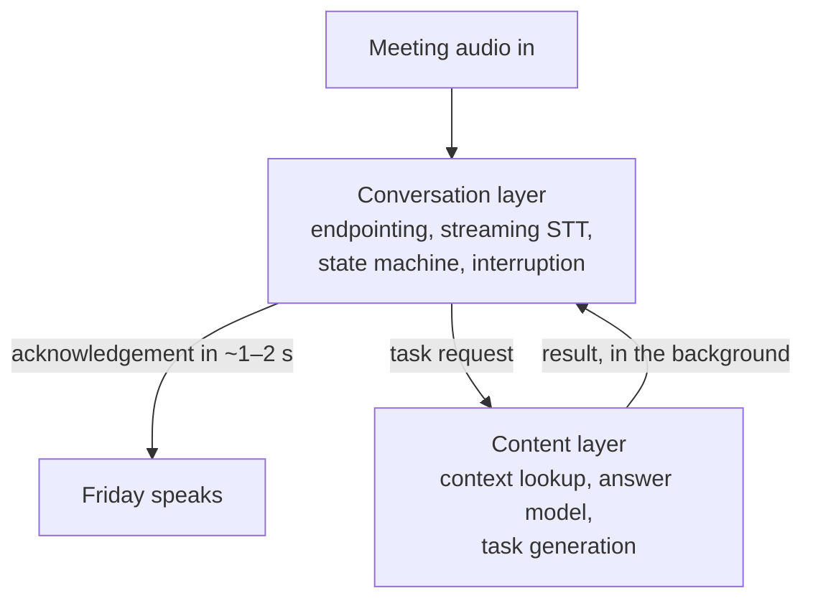
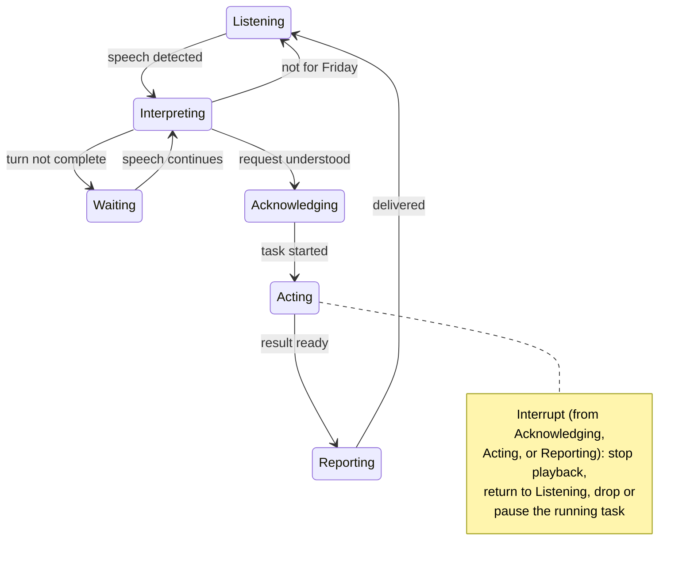

# Virtual Worker — Conversation Layer Plan (For Discussion)

Status: **draft for review with Viswanath.** Nothing here is implemented, and
the conversation-layer implementation choice is **not finalized** — see
section 5.

Supporting material: [`latency-findings.md`](latency-findings.md) (measured
baseline), [`next-steps.md`](next-steps.md) (validated direction).

## 1. Goal

Make Friday feel responsive: the user should hear an acknowledgement within
**~2 seconds** of finishing a request, instead of today's **7.77 s median**
first audio.

**Non-goals for this phase:** no provider, model, region, or endpoint changes;
no speaker identification or live translation; no memory or broader workflows.

## 2. How the conversation layer behaves

Two layers, as decided in M4/M5:

- The **conversation layer** owns the audio loop and all timing-critical
  decisions: endpointing, turn detection, acknowledgement, interruption. It
  never blocks on the content layer.
- The **content layer** (unchanged) runs in the background: context lookup,
  answer model, task generation.

States, per M5 — the normal flow reads top to bottom; interrupts are covered
by the note:

- **Waiting**: audio still arrives, but unrelated speech is not turned into a
  new task.
- **Acting**: the task runs in the background; long tasks may get an interim
  "it's almost ready" update.

## 3. Target timings

The interaction flow in one line: user speaks → streaming STT runs while they
speak → end of turn detected → acknowledgement plays (~1–2 s after speech
ends) → task starts in background → corrections or interruptions handled →
answer spoken when ready, interruptible.

| Stage | Today | Target | How |
|---|---|---|---|
| Endpointing | ~2.0 s fixed silence window | ~0.3–0.5 s | VAD + end-of-turn model instead of a timer |
| STT | ~1.54 s after speech ends | ~0 s added | Streaming STT runs while the user speaks |
| Acknowledgement decision | — | ~0.2–0.3 s | Small fast decision in the state machine |
| First TTS audio | ~2.45 s (waits for full first sentence) | ~0.3–0.5 s | Stream TTS; play the first safe chunk |
| **Total to acknowledgement** | **7.77 s** | **~1–2 s** | Sum of the above |
| Full answer | ~20 s | unchanged, interruptible | Content layer unchanged; playback streams |

## 4. First-phase scope

This implementation phase starts **only after the M6 Pipecat demo** (see
section 5); the demo results feed the option choice and the integration
approach.

Three workstreams, in dependency order:

1. **Audio loop rewrite** — VAD + streaming endpointing, the state machine,
   and barge-in qualification (user interrupt vs. background noise).
2. **Streaming STT** — text ready when the turn ends, not 1.5 s later.
3. **Streaming TTS** — play the first safe chunk instead of the complete
   first-sentence WAV.

## 5. Conversation layer — implementation options (not finalized)

> Decision pending with Viswanath. Once an option is finalized, the
> integration approach follows from it. Pipecat was the research favorite but
> is **not** a decision. M6 set the gate: build a minimal standalone Pipecat
> demo measuring latency, cost, and the acknowledge-before-long-process
> behavior — the option choice follows from those results (see
> [`next-steps.md`](next-steps.md), "M6 follow-up").

| Option | What it is | Trade-off |
|---|---|---|
| **A. Pipecat framework** | Python voice-agent framework (BSD-2, very active): VAD, streaming STT/TTS, turn detection, barge-in built in. We add one custom transport bridging `vw_mic`/`vw_tts` and one processor holding the state machine. | Fastest to the full experience; adds a framework dependency and version churn. |
| **B. Component integration** | RealtimeSTT + Silero VAD + smart-turn wired into our own loop; we write the state machine ourselves. | Lower dependency risk; more hand-written orchestration to build and maintain. |
| **C. Patch current pipeline only** | Streaming TTS + VAD endpointing on the existing code; no framework, no new STT stack. | Smallest change; state machine still hand-built; slowest path to the full experience. |
| **D. Single audio model, no framework** | OpenAI `gpt-audio-mini` via OpenRouter: audio in/out with tool calling (verified supported). One model replaces STT + LLM + TTS — 128k context, already the configured TTS model. Audio density ~600 tokens/min; cost ~₹3.4/meeting-hour via OpenRouter (audio billed at text rates there) vs ~₹46/hour direct OpenAI. We keep only VAD endpointing, barge-in, and the state machine. | No framework at all and likely the cheapest path; unknowns are real first-audio latency through streaming chat completions, OpenRouter audio-chunk streaming, and which audio rate actually applies — all measured in the demo. |

Excluded during research: LiveKit Agents (requires its own WebRTC
infrastructure), TEN Framework (too heavy), Vocode (unmaintained).

If Option A were chosen, the integration shape is: keep `browser.py` (Teams
join), the virtual-mic audio graph, the backend, and the benchmarks; replace
the hand-written audio loop, batch STT, and the wait-for-full-WAV TTS; run
both old and new behind `VW_CONV_ENGINE=legacy|pipecat` for A/B benchmarking.

## 6. Benchmark and acceptance criteria

1. Baseline (recorded): **7.77 s median first audio**, 20.32 s median full
   answer; local five-trial runs plus one live Teams run.
2. After each workstream: same test conditions, same speech samples.
3. Acceptance: acknowledgement starts **≤ 2 s** after end of speech; interrupt
   stops playback **≤ 0.5 s**; no regression in answer correctness.

## 7. Open questions for the discussion

1. **Acknowledgement wording** — one generic phrase vs. echoing a summary of
   what Friday understood (M3 leaned toward a summary; it costs a little more
   time to generate).
2. **Interruption semantics** — during **acting**, always drop the background
   task, or pause-and-resumable?
3. **Wake-word reliability** — live tests showed wake-word misrecognition
   ("Pradhy", "Grady"). Wake-word verification or semantic detection?
4. **Progress updates** — threshold for when a long task deserves an interim
   update.
5. **Option choice** — A, B, C, or D from section 5; gated on the M6 Pipecat
   demo results (and, for D, the same demo run through the single audio
   model).
6. **TTS streaming cost** — streaming/live TTS may cost more (M4 concern);
   acceptable trade-off?