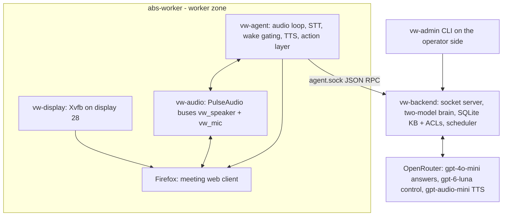
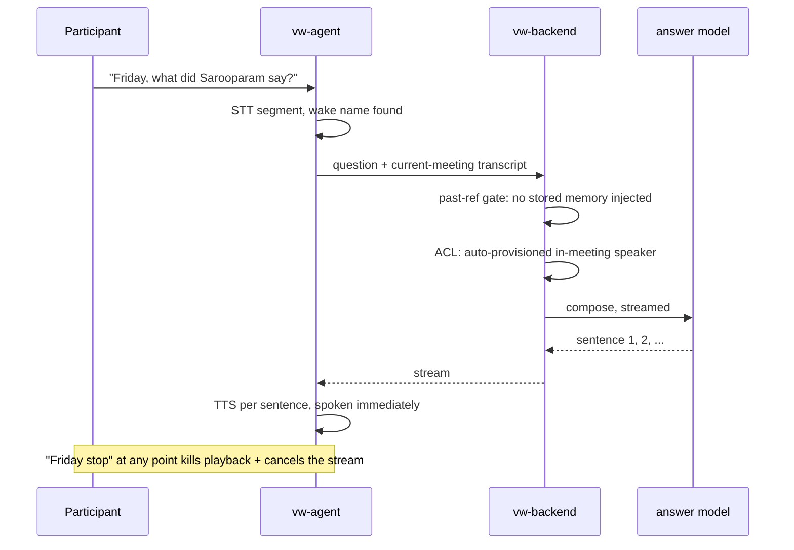
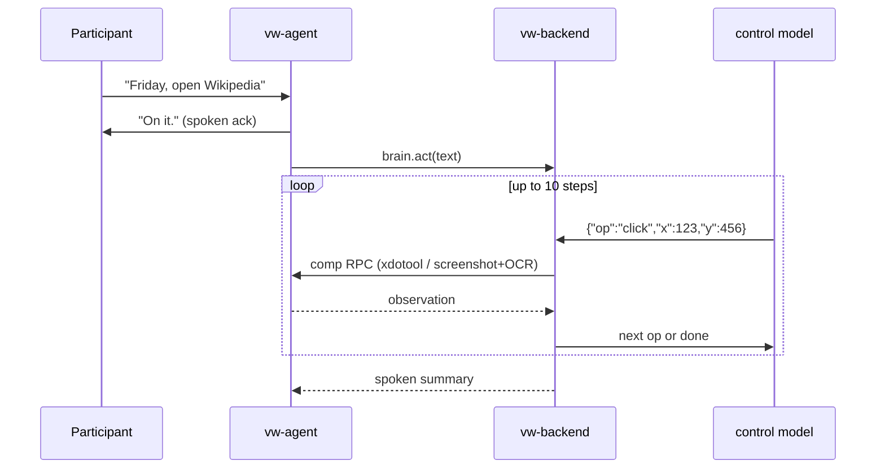
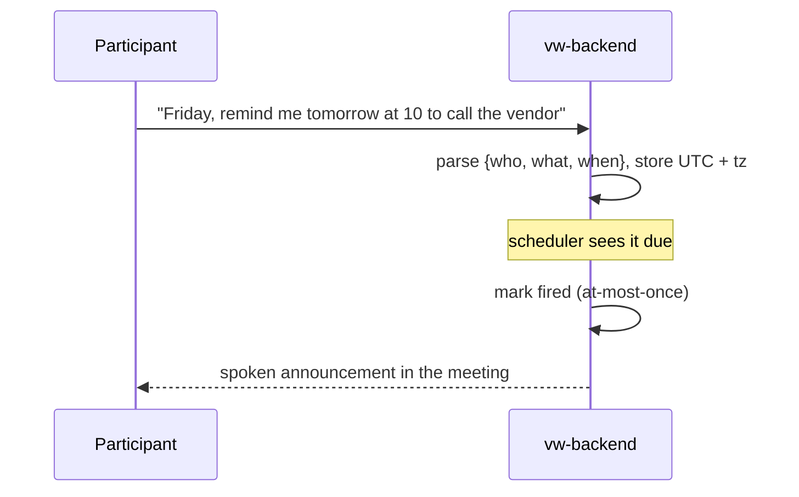
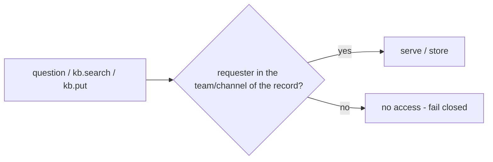

# Virtual Worker — Design Document (as deployed)

Source requirements: [`docs/requirements.md`](requirements.md)
Architecture diagrams: [`docs/architecture.md`](architecture.md)

---

## Contents

1. [Overview](#1-overview)
2. [Why a separate Linux user](#2-why-a-separate-linux-user)
3. [System architecture](#3-system-architecture)
4. [Deployment](#4-deployment)
5. [Runtime design](#5-runtime-design)
6. [Conversation discipline ("Friday" rules)](#6-conversation-discipline-friday-rules)
7. [The two brains](#7-the-two-brains)
8. [Key flows](#8-key-flows)
9. [Data model and storage](#9-data-model-and-storage)
10. [Access control](#10-access-control)
11. [Testing](#11-testing)
12. [Known limitations and deferred work](#12-known-limitations-and-deferred-work)
13. [Repository layout](#13-repository-layout)

---

## 1. Overview

**Goal:** a virtual worker joins an online meeting (Google Meet **and**
Microsoft Teams), listens quietly, answers aloud when called by name, acts as
a general computer-controlling agent for commands, remembers discussions,
delivers reminders, and only exposes meeting information to authorized users.

| Decision | Value (as deployed) |
|---|---|
| Worker name | **Friday** — set by `VW_NAME`; drives the wake word, personas, TTS prompt, and the name typed into join screens |
| Meeting platforms | Google Meet and Microsoft Teams, joined from shared links |
| How it joins | Vision-driven browser automation on its own virtual display; sees the same UI a human sees |
| Runs as | Dedicated Linux user `abs-worker` on the host, own systemd user instance — not a container |
| Brain | Two models behind a small backend service: a fast answer composer and a tool-calling control model |
| Storage | SQLite knowledge base with team ACLs, owned by the backend |
| Voice | Female neural TTS (ElevenLabs engine wired, OpenRouter `gpt-audio-mini` as the working default, espeak only as last-resort fallback) |

History: the worker was prototyped as "Alex", renamed "Luna", and finally
"Friday". Everything below reflects the current system; the conversation
discipline in §6 is what the final round of fixes (Luna 3.0 / Friday)
delivered.

---

## 2. Why a separate Linux user

The worker runs unattended browser automation with its own meeting identity,
display, and audio stack. Isolating it under `abs-worker` gives:

- **Credential isolation** — meeting links, browser profile, and API keys live
  under `/home/abs-worker` (env file mode `600`); a compromised worker cannot
  read the operator's files.
- **Session isolation** — the worker owns its virtual display (`:28`) and
  PulseAudio instance; it never attaches to the operator's X/Pulse session.
- **Blast-radius control** — the browser and automation are the only things
  that can misbehave, and they can only touch the worker's own home.
- **Multi-instance readiness** — a second worker is one more agent instance
  talking to the same backend over its own socket.

---

## 3. System architecture

Two trust zones: the worker zone (agent, display, audio, browser) runs as
`abs-worker` under systemd **user** units; the backend is a separate process
that owns all data. The only bridge is one Unix socket,
`~/vw-data/run/agent.sock`.



Component responsibilities:

| Component | Responsibility |
|---|---|
| `vw-display.service` | Xvfb virtual display `:28`, 1920×1080, for the browser and all vision work |
| `vw-audio.service` | Per-user PulseAudio: `vw_speaker` null sink (meeting audio in), `vw_mic` virtual source (worker voice out) |
| `vw-agent.service` | Audio loop (capture → STT → segments), wake/command gating, TTS playback, action layer (xdotool, RapidOCR, screenshots, `route_audio`) |
| `vw-backend.service` | Unix socket server, `question` fast path, `Brain.act` tool loop, transcript/KB persistence with ACLs, reminder scheduler |

The agent never calls the LLM directly and never touches the database; every
model call, memory read/write, and ACL check goes through the backend.

---

## 4. Deployment

### 4.1 Account, data layout, deploy loop

```bash
sudo useradd --system --create-home --shell /bin/bash abs-worker   # deploy/setup-user.sh
bash deploy/sync.sh         # rsync code to ~/virtual-worker
ssh abs-worker@localhost 'systemctl --user restart vw-backend vw-agent'
```

```
/home/abs-worker/
  virtual-worker/           code (agent/, backend/, common/, deploy/)
  venv/                     Python environment
  vw-data/
    config/worker.env       secrets + config, mode 600
    db/kb.db                SQLite knowledge base (backend-owned)
    run/agent.sock          Unix socket, the only IPC bridge
    logs/                   service logs
```

`worker.env` (from `deploy/env.template`) holds `VW_NAME=Friday`,
`VW_TEAM`, `VW_TZ`, STT tuning (`VW_STT_MODEL=small.en`,
`VW_STT_SILENCE=0.7`, `VW_STT_WINDOW_MAX=20`), model selection
(`VW_CONTROL_MODEL=openai/gpt-6-luna`, `VW_TTS_*` incl. ElevenLabs voice and
empty key slot), `VW_ACTION_DISPLAY=:28`, `VW_XAUTHORITY`, and the worker's
OpenRouter key.

### 4.2 systemd user units

`deploy/systemd-user/` contains `vw-display`, `vw-audio`, `vw-backend`,
`vw-agent`. They run under the `abs-worker` **user instance**
(`systemctl --user`), so no root involvement after bootstrap. The browser is
launched by the agent on `:28` (headless is unreliable for meeting UIs) with
a dedicated Firefox profile.

### 4.3 Backend ↔ agent IPC

- One Unix socket: `~/vw-data/run/agent.sock`.
- JSON request/response framing (`common/vw_common`), `hello` → `result` with
  `req_id`.
- Worker-zone handlers live in the agent; brain-zone handlers in the backend
  and are forwarded over the socket, so both CLI and agent speak the same
  protocol. Key types: `question`, `brain.act`, `brain.cancel`, `action.run`
  (rejoin/leave), `agent.say`, `meeting.start`, `transcript.append`,
  `kb.put`/`kb.search`, `reminder.create`, `reminders.list`, `status`,
  `selftest`.

---

## 5. Runtime design

### 5.1 Joining meetings (req 1)

The agent drives Firefox on `:28` with screenshots + OCR (RapidOCR) +
xdotool — no platform APIs, so Meet and Teams share one code path. The join
flow is a `Brain.act` tool loop (vision-driven) or the scripted action layer:

- Load the meeting URL; on the pre-join screen **clear the name field
  completely** (Ctrl+A, Delete) and type `VW_NAME` exactly once — the field
  otherwise compounds the stored previous name ("LunaLunaLuna").
- Camera off, microphone `VirtualWorker_Mic` **enabled**, speaker
  `VirtualWorker_MeetingAudio`; allow Firefox's mic-permission prompt.
- Meet: lobby + human admission (anonymous admission is Google's
  IP/identity scoring — a fresh Firefox profile resets the anonymous
  identity; repeated automated joins from one IP get throttled).
- Teams: auto-admit; Teams may cache an earlier no-audio choice as an
  interstitial modal that must be dismissed before the page will reload.
- After admission: `route_audio()` moves Firefox's sink-input onto
  `vw_speaker` and its source-output onto `vw_mic`; `meeting.start` registers
  the meeting (platform, URL, team) so transcripts, ACLs, and summaries
  attach to it.

### 5.2 Listening and speaking (req 2)

- **In:** meeting audio → `vw_speaker` → `vw_speaker.monitor` →
  faster-whisper (`small.en`) with energy-based endpointing → timestamped
  transcript segments → `transcript.append`.
- **Out:** answer text → TTS (engine `auto`: ElevenLabs when a key is
  configured, else OpenRouter `gpt-audio-mini` neural voice `nova`, else
  espeak) → `vw_tts` → `vw_mic` → browser capture → the meeting hears a
  normal participant.
- Playback is **interruptible**: TTS renders to a WAV and plays via a child
  process, so "Friday stop" can kill it mid-sentence (§6).
- After any restart, `route_audio()` re-binds Firefox to the worker buses —
  the standard repair when device dropdowns show "None".

### 5.3 Screen understanding (req 6)

- Screenshot on `:28`, OCR (RapidOCR) with `locate_all` / `locate_lowest`
  helpers (meeting UIs duplicate heading labels; the lowest match is the
  input field), then targeted clicks/typing. Vision ops are executed
  agent-side via the `comp` RPC; the control brain sees returned text and
  screenshots.

### 5.4 Memory (req 3)

- Transcript segments, rolling summaries, and KB entries are stored with the
  meeting's team context.
- Full-text search (SQLite FTS) with an OR-of-tokens fallback for recall.
- **Recall gating (see §6):** stored memory is consulted only for questions
  that explicitly reference the past; in-meeting questions are answered from
  the current meeting's transcript alone.

### 5.5 Reminders (req 4, 5)

- Utterances matching the reminder pattern become `{who, what, when}`
  records (times parsed and stored as absolute UTC plus requester zone).
- A reminder is only created when the worker is **addressed** — another
  participant saying "remind me..." must not schedule anything.
- The scheduler polls for due reminders; each is marked fired before
  dispatch (at-most-once) and announced aloud.

---

## 6. Conversation discipline ("Friday" rules)

These are hard behavioral requirements, implemented in the agent's gating
loop and in the personas:

1. **Speak only when called.** A transcript segment triggers work only when
   the wake name is present (arms a 12 s window) or within a 30 s follow-up
   window of the last exchange. Everything else is silent listening.
2. **No unprompted speech.** Rejoining the meeting is silent; reminders fire
   only if she was addressed; the persona forbids volunteering recaps,
   opinions, or memories unasked.
3. **Stop instantly.** "Friday stop / stop Friday / be quiet / shut up /
   that's enough / never mind" is checked **before** the echo guard, so it
   works even while she is mid-sentence: playback process killed, cancel
   token bumped (in-flight answer and tool-loop output dropped),
   `brain.cancel` aborts the backend loop at the next step. Precise matching
   keeps "Friday, stop sharing your screen" a command, not a halt.
4. **Never quote other sessions.** A past-reference regex decides whether a
   question may see stored memory: "what did we discuss last meeting?" gets
   KB/segments; "what did Sarooparam say?" gets the current transcript only.
5. **Acknowledge, then listen fully.** Commands get a short spoken ack
   ("On it.") before the brain acts; questions stream — the first sentence is
   spoken as soon as it is composed (low perceived latency).
6. **Tolerate STT noise.** Personas instruct inference over missing
   punctuation, fillers, and homophones; one focused clarifying question only
   when genuinely ambiguous; spoken style: direct answer first, ≤2 sentences,
   no markdown/URLs read aloud.

---

## 7. The two brains

| Role | Model | Path | Why |
|---|---|---|---|
| Answer composer | `openai/gpt-4o-mini` (`VW_BRAIN_MODEL`) | `question` → streamed answer | Low latency for spoken Q&A |
| Control brain | `openai/gpt-6-luna` (`VW_CONTROL_MODEL`) | `Brain.act` tool loop | Reliable JSON tool-calling for screen actions |

`Brain.act` is a loop: the model replies with one JSON op per turn —
`screenshot`, `click`, `double_click`, `type`, `key`, `scroll`, `locate`,
`wait`, `open_url`, `speak`, `remember`, `recall`, `done` — which the backend
executes via the agent's `comp` RPC and returns the observation for. The loop
is capped at 10 steps, checks the cancel token every step, and ends with a
short spoken summary. The control persona encodes the join-flow rules
(field clearing, device selection) so the same commands work on Meet and
Teams.

---

## 8. Key flows

### 8.1 Question (wake → streamed spoken answer)



### 8.2 Command (ack → tool loop)



### 8.3 Join (see architecture.md §6)

Operator hands the URL → vision-driven pre-join (name cleared and typed once,
camera off, mic on) → lobby/admission → `route_audio` + `meeting.start` →
silent listening.

### 8.4 Reminder



---

## 9. Data model and storage

SQLite (`~/vw-data/db/kb.db`), managed only by the backend:

| Table | Key fields |
|---|---|
| `meetings` | id, platform (`meet`/`teams`), url, started_at, team_id |
| `transcript_segments` | meeting_id, ts, speaker, text (FTS-indexed) |
| `summaries` | meeting_id, rolling summary text |
| `kb_entries` | text, team_id, channel_id, created_at (FTS-indexed) |
| `reminders` | who, what, due_at_utc, requester_tz, fired_at |
| `acl_members` | user_id, team_id, channel_id |

Old databases are archived in-place (e.g. `kb.db.pre-luna-*`) rather than
deleted, so a memory reset is reversible.

---

## 10. Access control

ACLs are enforced by the **backend on both write and read**; filesystem
permissions are only a second layer.



- Every record carries `team_id`/`channel_id`, linked at save time.
- In-meeting speakers are auto-provisioned (`ensure_member_of_team`) into the
  meeting's team — the PoC trust model; console/CLI callers carry explicit
  identities.
- A second worker is one more agent instance sharing the same backend, KB,
  and checks.

---

## 11. Testing

`tests/test_virtual_worker.py` (17 tests, `python3 -m pytest tests/ -q`):
ACL fail-closed behavior, reminder parsing, backend protocol handling,
message framing, past-reference gating, and stop-phrase precision (commands
like "stop sharing your screen" must not be treated as halts).

---

## 12. Known limitations and deferred work

**Known limitations:**

- **ElevenLabs key** — the engine is wired (voice `Jessica`,
  `eleven_flash_v2_5`) and auto-switches when
  `VW_ELEVENLABS_API_KEY` is added to `worker.env`; until then the default is
  OpenRouter neural TTS.
- **Meet admission** — anonymous joins are scored by Google; durable fix is a
  signed-in Google account for the worker (`GOOGLE_EMAIL`/`GOOGLE_PASSWORD`
  in `worker.env`, not yet configured) or fresh links per session.
- **Billing isolation** — the worker's OpenRouter key currently bills the
  operator's account; a separate account is the clean fix.
- **Worker's own Teams account** — a Teams account exists
  (`friday@abstractit.in`); joins currently use guest naming so the displayed
  name is exactly `VW_NAME`.

**Deferred:** calendar/external events beyond reminders; multiple concurrent
meetings per worker; repeats/cancellation for reminders; per-user
authentication for CLI access.

---

## 13. Repository layout

```
virtual-worker/
  docs/                     requirements.md, design.md, architecture.md
  agent/vw_agent/           agent.py (loop+gating), actions.py (vision/xdotool/routing),
                            audio.py (Pulse buses), stt.py, speak.py (TTS engines),
                            screen.py, browser.py, parse.py, config.py
  backend/vw_backend/       server.py (socket hub), brain.py (personas + Brain.act),
                            kb.py (SQLite+ACL), scheduler.py, cli.py
  common/vw_common/         socket framing shared by both zones
  deploy/                   setup-user.sh, sync.sh, bootstrap-abs-worker.sh,
                            env.template, systemd-user/*.service, vw-wrapper.sh
  tests/                    pytest suite
```