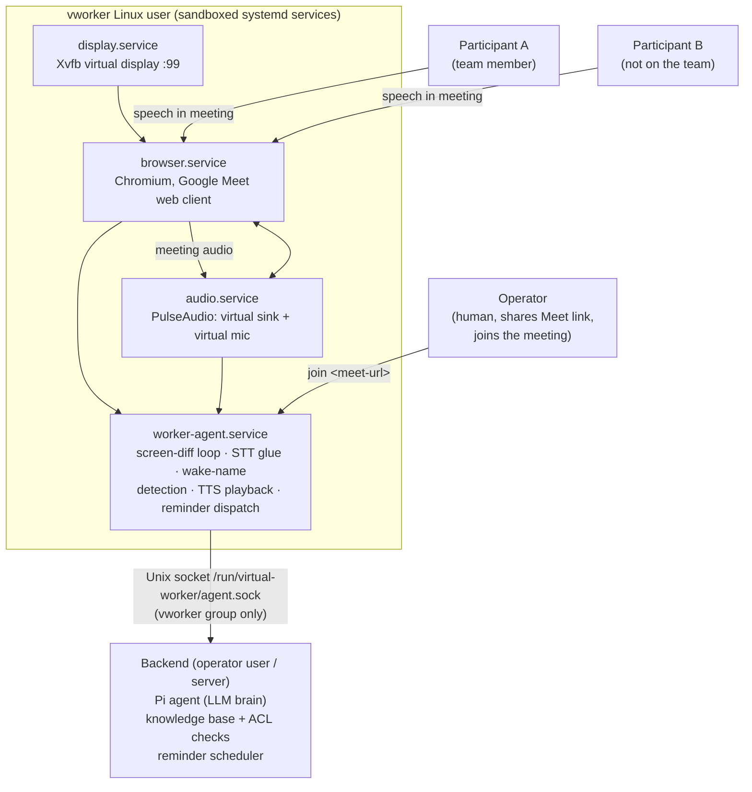
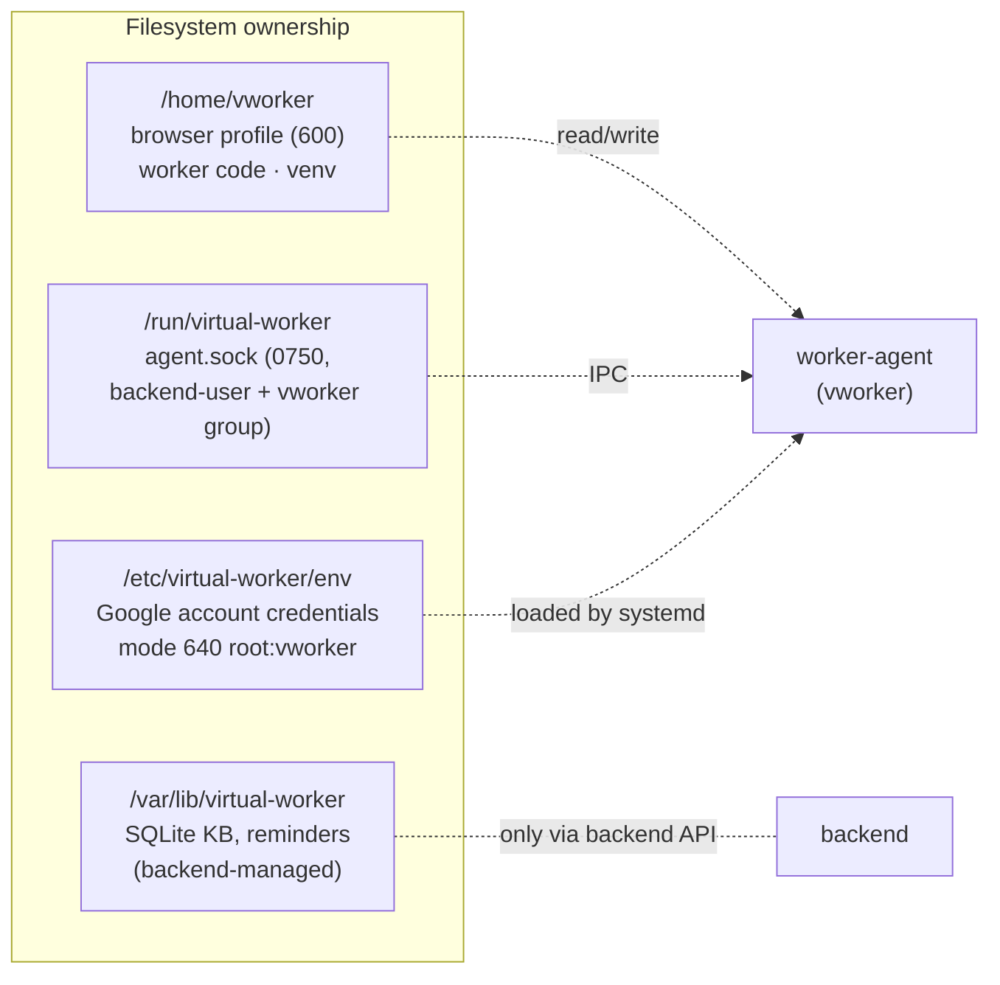
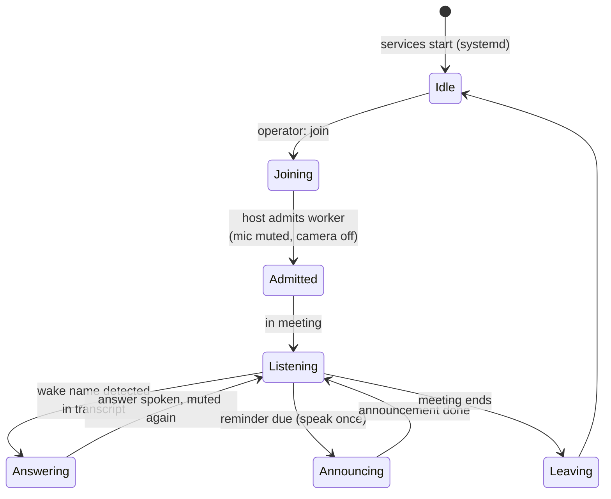
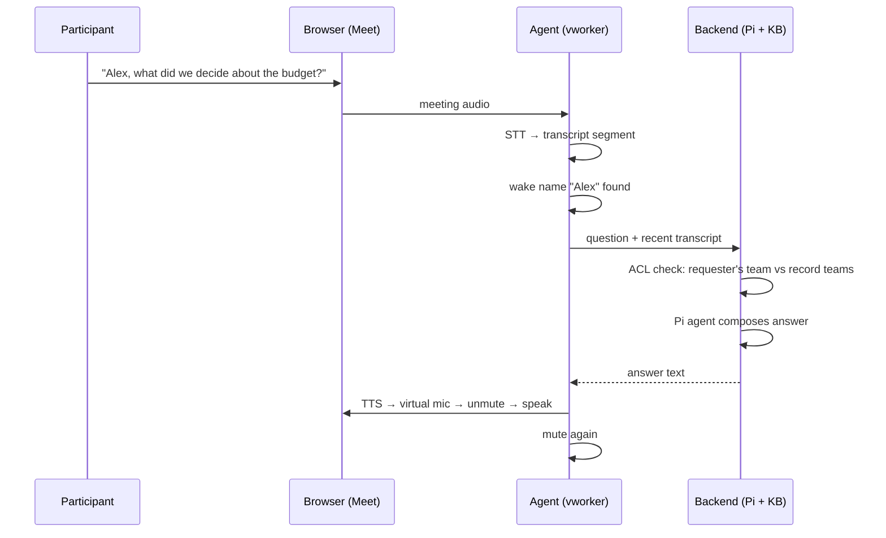
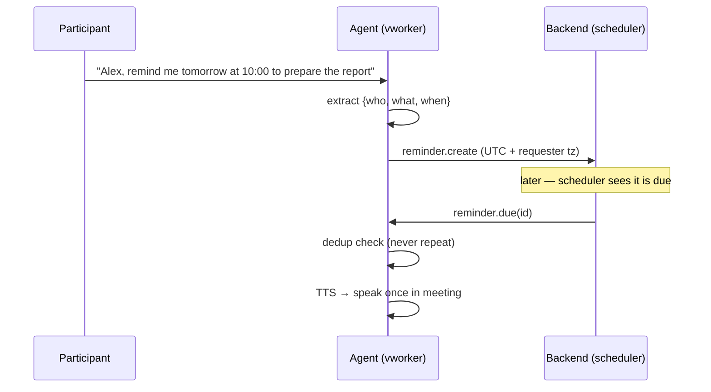
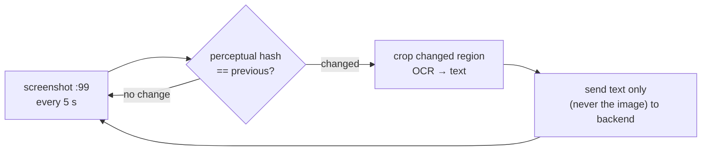
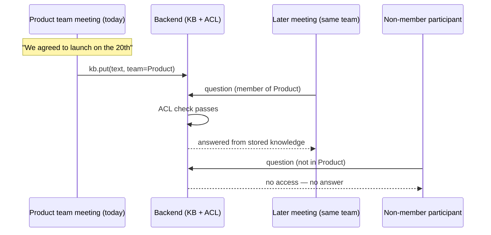
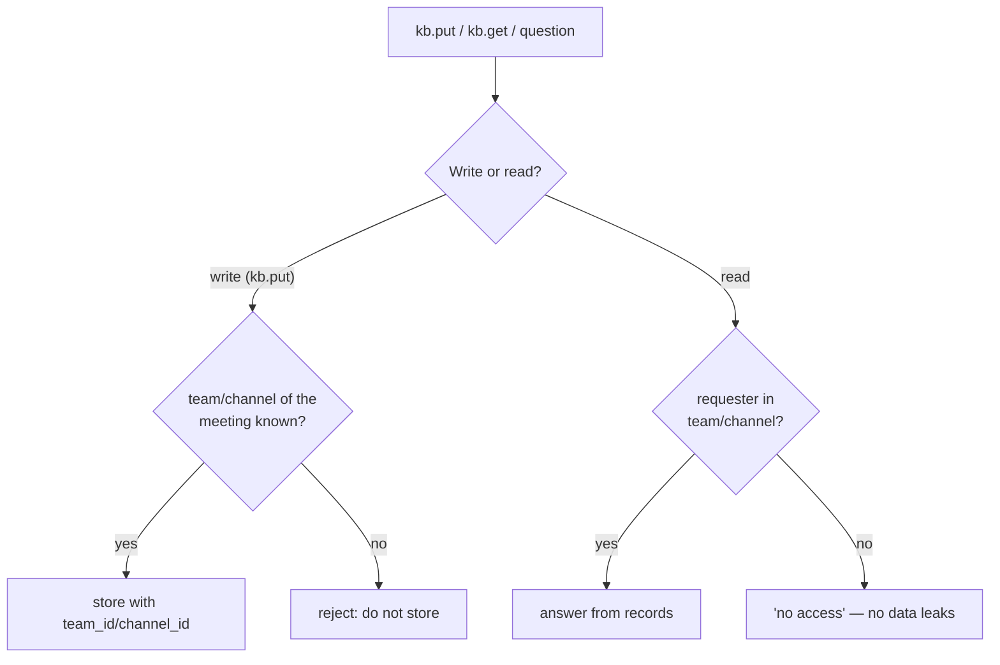
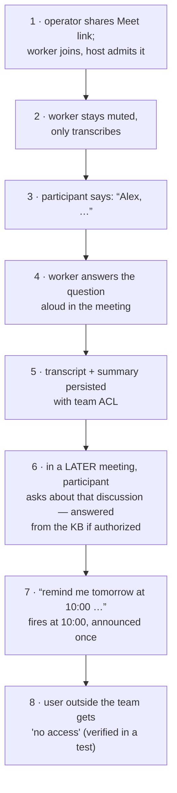

# Virtual Worker — Design Document (Proof of Concept)

Source requirements: [`docs/requirements.md`](requirements.md)

---

## Contents

1. [Overview](#1-overview)
2. [Why a separate Linux user](#2-why-a-separate-linux-user)
3. [System architecture](#3-system-architecture)
4. [Deployment under a separate Linux user](#4-deployment-under-a-separate-linux-user)
5. [Runtime design](#5-runtime-design)
6. [Key flows](#6-key-flows)
7. [Data model and storage](#7-data-model-and-storage)
8. [Access control](#8-access-control)
9. [PoC demo script](#9-poc-demo-script)
10. [Deferred and open questions](#10-deferred-and-open-questions)
11. [Repository layout](#11-repository-layout)

---

## 1. Overview

**Goal:** a virtual worker joins an online meeting, listens quietly, answers
aloud when called by name, remembers the discussion, delivers reminders, and
only exposes meeting information to authorized users.

**Decided for the first test:**

| Decision | Value |
|---|---|
| Meeting platform | Google Meet, joined from a shared link |
| How it joins | Manually — the operator gives the agent the link, it joins via a dedicated Google account and the host admits it |
| Runs as | A dedicated, sandboxed Linux user (`vworker`), not the operator's session |
| Brain | Pi agent (LLM) behind a small backend service |
| Storage | SQLite + SQLite-vec knowledge base with team/channel ACLs |

**PoC non-goals:** multiple meetings per worker, other platforms (Teams later),
proactive speech beyond reminders, interruption handling across meetings.

---

## 2. Why a separate Linux user

The worker runs unattended browser automation with its own meeting account,
display, and audio stack. Isolating it under a dedicated Linux user gives:

- **Credential isolation** — Google account credentials and browser profile live
  under `/home/vworker` (mode `600`); a compromised worker cannot read the
  operator's keys, files, or clipboard.
- **Session isolation** — the worker owns its own virtual display and audio
  server; it never attaches to the operator's X/PulseAudio session.
- **Blast-radius control** — systemd sandboxing (`ProtectSystem=strict`,
  `NoNewPrivileges`, no capabilities) limits what misbehaving automation can touch.
- **Multi-instance readiness** — each future worker is one more service unit
  talking to the same backend over a controlled socket (req 8).

---

## 3. System architecture

Two trust zones: everything inside the dashed box runs as the `vworker` Linux
user; the backend runs elsewhere (operator user or server) and owns all data.



Component responsibilities:

| Component | Runs as | Responsibility |
|---|---|---|
| `display.service` | `vworker` | Xvfb virtual display `:99` for the browser |
| `audio.service` | `vworker` | Per-user PulseAudio: meeting output looped into STT, virtual mic fed by TTS |
| `browser.service` | `vworker` | Chromium with a dedicated profile; joins Google Meet from the shared link |
| `worker-agent.service` | `vworker` | 5 s screen-change loop, transcript assembly, wake-name detection, TTS, reminder dispatch |
| Backend (Pi agent + KB + scheduler) | operator user or server | LLM reasoning, memory with ACLs, reminder store |

---

## 4. Deployment under a separate Linux user

### 4.1 Account and directories

```bash
sudo useradd --system --create-home --shell /bin/bash vworker
sudo mkdir -p /run/virtual-worker /var/lib/virtual-worker
sudo chown vworker:vworker /run/virtual-worker /var/lib/virtual-worker
```



Notes:

- No sudo for `vworker`; login shell enabled only while debugging.
- Secrets never live in the repository (`.env` is gitignored).

### 4.2 systemd units

`/etc/systemd/system/virtual-worker-display.service`

```ini
[Unit]
Description=Virtual worker virtual display
[Service]
User=vworker
ExecStart=/usr/bin/Xvfb :99 -screen 0 1920x1080x24
Restart=always
[Install]
WantedBy=multi-user.target
```

`/etc/systemd/system/virtual-worker.service` — the agent (display and audio are
its prerequisites):

```ini
[Unit]
Description=Virtual worker agent
Requires=virtual-worker-display.service virtual-worker-audio.service
After=network-online.target
[Service]
User=vworker
Environment=DISPLAY=:99
EnvironmentFile=-/etc/virtual-worker/env
ExecStart=/home/vworker/venv/bin/python -m virtual_worker.agent
Restart=on-failure
# --- sandboxing ---
NoNewPrivileges=yes
ProtectSystem=strict
ReadWritePaths=/home/vworker /run/virtual-worker
PrivateTmp=yes
ProtectHome=read-only
RestrictAddressFamilies=AF_UNIX AF_INET AF_INET6
CapabilityBoundingSet=
[Install]
WantedBy=multi-user.target
```

The browser is launched by the agent on Xvfb (headless is unreliable for
meeting UIs); its profile lives in `/home/vworker/.browser-profile`.

### 4.3 Backend ↔ agent IPC

- Unix domain socket `/run/virtual-worker/agent.sock`, directory mode `0750`,
  owned by the backend user plus the `vworker` group.
- JSON request/response messages: `transcript.append`, `question`, `speak`,
  `reminder.create`, `reminder.due`, `kb.put`, `kb.get`.

---

## 5. Runtime design

### 5.1 Joining the meeting (req 1)

- Platform: **Google Meet**, joined from a link the operator shares
  (`join <url>`); the agent never discovers or accepts meetings on its own.
- The agent drives Chromium on `:99` through the pre-join screen with the
  dedicated Google account: camera off, mic connected but **muted on entry**,
  then "Ask to join" — the human host admits the worker (consent signal).

### 5.2 Listening and speaking (req 2)

- **Audio in:** PulseAudio loopback of meeting audio → chunked local STT
  (Pi Voice / Whisper-class model) → timestamped transcript segments.
- **Wake detection:** every new segment is scanned for the configured wake name
  (e.g. "Alex"). Only then does the agent consult the backend.
- **Speak:** backend answer → TTS → virtual mic → unmute → speak → mute.
  The worker never initiates speech unprompted in the PoC.

### 5.3 Screen change detection (req 6)

- Screenshot every 5 s on `:99`; compare a perceptual hash with the previous
  frame. On change only: crop the changed region, OCR it, and send the
  extracted **text** (never the image) to the backend. Catches chat messages
  and participant changes that audio STT misses. Interval and method are
  tunable config constants.

### 5.4 Memory (req 3)

- Transcript segments and rolling summaries are stored with the meeting's
  team/channel context; questions may be answered from the current meeting or
  from previously stored, authorized knowledge.

### 5.5 Reminders (req 4, 5)

- Utterances matching the reminder pattern become `{who, what, when}` records.
- The scheduler polls for due reminders and calls the agent's `speak`; each
  reminder carries a dedup flag so it is announced **once**.
- Times stored as absolute UTC plus the requester's IANA zone. Cancellation
  and repeats are out of PoC scope but the schema allows them.

### 5.6 External events (req 5, deferred)

PoC implements only reminder-due events. Other sources (calendar invites,
notifications) plug into the same `event → relevance decision → speak once`
pipeline later.

---

## 6. Key flows

### 6.1 Worker lifecycle



### 6.2 Wake and answer (PoC demo step 4)



### 6.3 Reminder (PoC demo step 7)



### 6.4 Screen change detection loop (req 6)



### 6.5 Shared knowledge across meetings (req 3, 7, 8)



---

## 7. Data model and storage

Stored in `/var/lib/virtual-worker` (SQLite + SQLite-vec), managed only by the
backend:

| Table | Key fields |
|---|---|
| `meetings` | id, platform (`meet`), started_at, team_id |
| `transcript_segments` | meeting_id, ts, speaker, text |
| `summaries` | meeting_id, rolling summary text |
| `kb_entries` | text, embedding, team_id, channel_id, created_at |
| `reminders` | who, what, due_at_utc, requester_tz, dedup_flag, fired_at |
| `acl_members` | user_id, team_id, channel_id |

Retention and consent rules (how long data is kept, recording consent) are
[open questions](#10-deferred-and-open-questions).

---

## 8. Access control

ACLs are enforced by the **backend on both write and read** — filesystem
permissions are only a second layer, never the mechanism.



- Every record carries `team_id` / `channel_id` (linked at save time).
- A question is answered only from records whose team/channel the requester
  belongs to.
- Later: one worker per meeting = one more `worker-agent` instance, all sharing
  the same backend and KB with these same checks (req 8).

---

## 9. PoC demo script

Maps to the PoC scope list (requirements, items 1–8):



---

## 10. Deferred and open questions

**Deferred:** Teams and other platforms; multiple meetings per worker;
interruption handling while in a meeting; proactive external-event announcements
beyond reminders.

**Open questions:**

- Exact wake name and command grammar.
- Should the worker appear muted while listening? *(proposed: yes)*
- How much to store: full transcript, summary, or both? *(proposed: both)*
- Reminder edge cases: time zones *(UTC + requester IANA zone, proposed)*,
  cancellation, repeats.
- Data retention period; security, privacy, and **recording consent** rules —
  a recording-consent notice is recommended before the PoC demo.

---

## 11. Repository layout

```
virtual-worker/
  docs/                     requirements.md, design.md
  agent/                    worker-agent (Python): screen loop, STT/TTS glue,
                            wake detection, browser automation
  backend/                  Pi agent config, KB service, scheduler, ACL checks
  deploy/                   systemd units, user setup script, env template
  tests/                    ACL tests, reminder scheduling tests, protocol tests
```