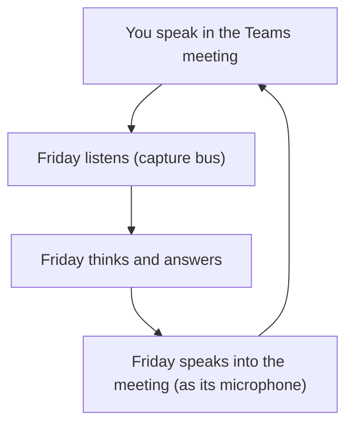
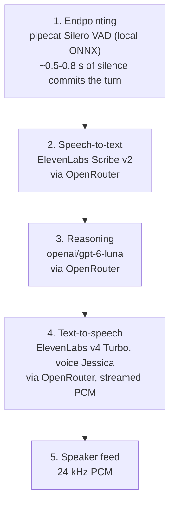
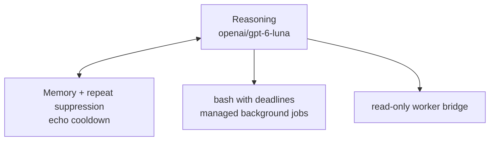
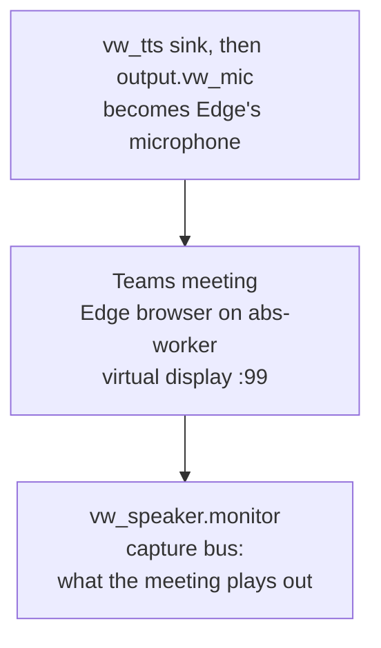
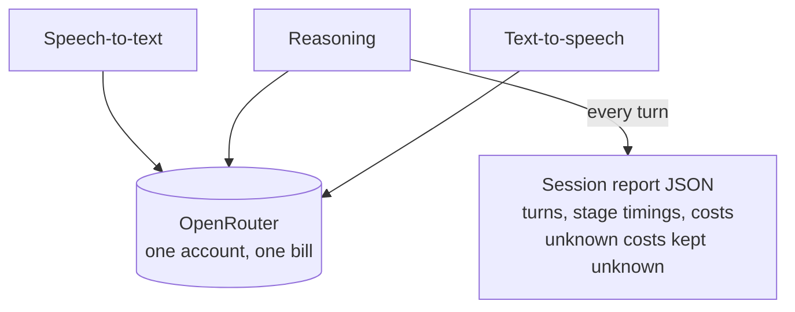

# Friday voice architecture — live Teams build (as of 2026-11-05)

One voice worker ("Friday") joins a Teams meeting in an Edge browser on the
shared host `abs-worker` (headless virtual display). Audio flows through
dedicated PulseAudio buses so the meeting and the worker never use the RDP
devices. All three model calls are billed through a single OpenRouter account.
Every turn is written to a JSON session report with timings and costs.

The architecture is split into four small diagrams: the overall conversation
loop, the Friday internals, the audio transport, and the reporting.

## 1. Overall loop (the conversation cycle)

One turn: your speech is captured, transcribed, reasoned about, and spoken
back — then Friday keeps listening.

## 2. Friday internals (the five stages, one process)

The reasoning stage also carries tools and memory:

## 3. Audio transport (how audio physically moves)

Known weak spot: PulseAudio streams drift here (Edge slides back to the RDP
devices, Friday's capture stream can disappear) and there is no watchdog yet —
when it happens, Friday goes deaf until manually restarted.

## 4. Reporting and billing

## Alternates measured (same skeleton, different services)

- Realtime mode (`chat.py`): runs entirely inside pipecat's pipeline with
  `OpenAIRealtimeLLMService` — fastest round trip measured (~4.3 s).
- Separate mode with OpenAI-direct models: ~4.6 s round trip.
- Current ElevenLabs + Luna configuration: ~7–8 s round trip (measured), with
  streaming TTS shaving the tail.