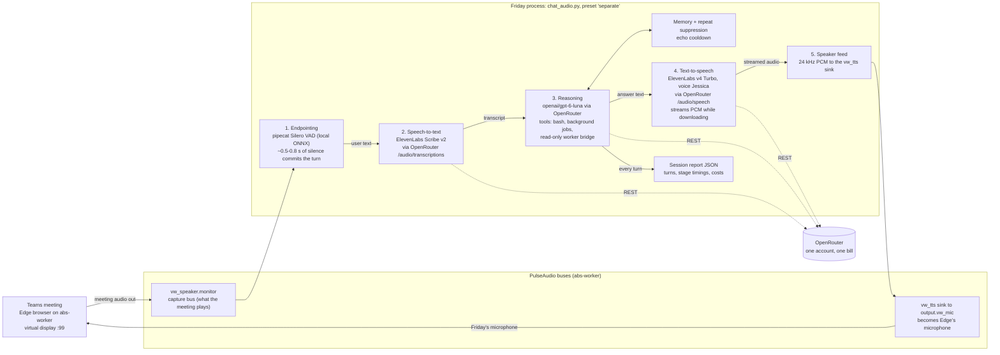

# Friday voice architecture — live Teams build (as of 2026-11-05)

One voice worker ("Friday") joins a Teams meeting in an Edge browser on the
shared host `abs-worker` (headless virtual display). Audio flows through
dedicated PulseAudio buses so the meeting and the worker never use the RDP
devices. All three model calls are billed through a single OpenRouter account.
Every turn is written to a JSON session report with timings and costs.

## Diagram

## Component notes

| Box | Implementation | Network |
|---|---|---|
| Endpointing | pipecat `SileroVADAnalyzer` (local ONNX model) + pipecat resampler | none (local) |
| Speech-to-text | POC code calling `POST /audio/transcriptions` | OpenRouter |
| Reasoning + tools | POC `SharedReasoner` (`poc_reasoning.py`), bash with process-group kill and deadlines, managed background jobs (`poc_jobs.py`) | OpenRouter |
| Text-to-speech | POC code calling `POST /audio/speech`, raw PCM streamed during download; ffmpeg-decode fallback for endpoints without PCM support | OpenRouter |
| Reports | POC `poc_report.py` — per-turn timings, per-stage costs, unknown costs kept explicitly unknown | none |

## Known weak spot

The audio-bus layer is the fragile part: PulseAudio streams drift (Edge slides
back to the RDP devices, Friday's capture stream can disappear) and there is no
watchdog yet to restore routing or reconnect capture automatically. When that
happens Friday goes deaf until manually restarted.

## Alternates measured (same skeleton, different services)

- Realtime mode (`chat.py`): runs entirely inside pipecat's pipeline with
  `OpenAIRealtimeLLMService` — fastest round trip measured (~4.3 s).
- Separate mode with OpenAI-direct models: ~4.6 s round trip.
- Current ElevenLabs + Luna configuration: ~7–8 s round trip (measured), with
  streaming TTS shaving the tail.