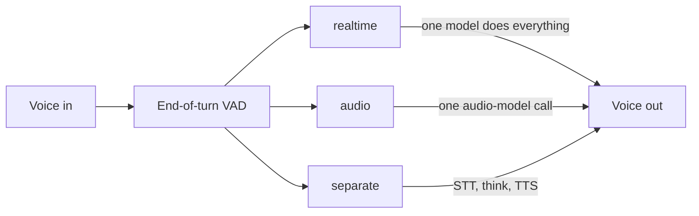

# Implementation plan — three conversation modes in the Pipecat POC

*Goal: `pipecat-poc` runs one talkable CLI in three usage-named modes;
build ~3 h one-shot, testing ~30 min by Sarooparam.*

## Modes (named by usage)
| Mode (type) | Pipeline | First audio |
|---|---|---|
| `realtime` | one realtime model — listens, thinks, speaks (live session) | ~1.2 s |
| `audio` | one audio-model call per turn (HTTP, OpenRouter) | ~2.4 s |
| `separate` | separate models — transcriber → think model (tools) → voice model | ~3.5 s |

## Build timeline

```mermaid
gantt
    dateFormat X
    axisFormat %s
    section Build ~3h
    Scaffolding, run.sh modes, config      :s1, 0, 1
    realtime mode (port current pipeline)   :s2, after s1, 1
    audio mode (OpenRouter adapter)       :s3, after s2, 2
    separate mode (Whisper STT + think TTS):s4, after s3, 3
    section Handover
    Self-tests with recorded fixtures      :s5, after s4, 4
    Sarooparam live test, fixes            :s6, after s5, 5
```

## Steps

1. **Scaffold** — `./run.sh realtime|audio|separate`; `models.ini` gains per-mode model fields; README updated.
2. **realtime** — current Pipecat realtime pipeline becomes mode 1; little new code.
3. **audio** — OpenRouter gpt-audio-mini as a custom Pipecat LLM service (streaming SSE → audio frames). *Fallback if it fights the framework:* the proven hand-built engine behind the same `run.sh audio` interface.
4. **separate** — faster-whisper STT (local, reliable) + think model with native tools + voice-model TTS; per-stage latency/cost printed.
5. **Parity + handover** — barge-in, memory, turn reports identical across modes; self-test each mode with `CHAT_TEST_WAV` fixtures; Sarooparam tests live and I fix findings.

## Follow-on (M8, after mode handover)

- Document-summaries agent: folder/CWD as source data, `bash`/shell tool on
  the think model, summaries written to file — separate half-day estimate.