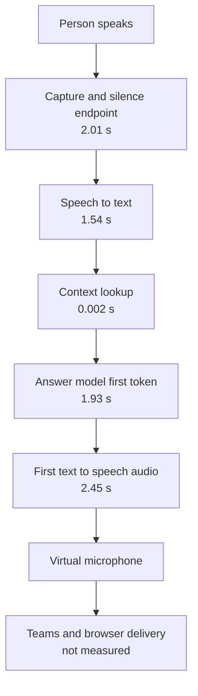

# Virtual Worker — Latency Summary

Latest benchmark: five local question-and-answer trials on 28 October 2026
with expanded stage instrumentation. This measures the worker's local
pipeline, not a complete live Teams call.

## Current latency

- First spoken audio: **7.77 seconds median**, **10.65 seconds maximum**
- Complete spoken answer: **20.32 seconds median**, **26.06 seconds maximum**

These are five-trial results, so the maximum is reported instead of calling it
an independent P95.

## Expanded measurement — 28 October 2026

The worker was measured again with stage boundaries across the agent audio
path and backend context path. The test used the unchanged local-worker
pipeline and
did not include a live meeting participant.

| Stage | Median | Five-trial maximum |
|---|---:|---:|
| Speech to endpoint | 2.01 s | 4.01 s |
| Endpoint to recognized text | 1.54 s | 1.64 s |
| Context request round trip | 1.5 ms | 1.6 ms |
| Backend context processing | 1.1 ms | 1.2 ms |
| Model request to first token | 1.93 s | 2.64 s |
| First TTS audio generation | 2.45 s | 2.97 s |
| Speech to first audio | 7.77 s | 10.65 s |
| Full spoken response | 20.32 s | 26.06 s |

The context lookup and the local agent-to-backend transport are negligible in
this run. The meaningful first-response contributors are endpointing, CPU STT,
model time to first token, and first TTS audio generation. Full-answer time is
also strongly affected by the length of the answer being spoken.

The model timing still combines network transport, OpenRouter routing, provider
queueing, and model generation. It does not identify the internal provider
portion separately. Browser capture, meeting transport, and the time at which a
remote participant hears the response remain unmeasured.

## Network and provider research

From the isolated worker environment on 28 October 2026:

- DNS resolved `openrouter.ai` to two Cloudflare edge addresses.
- Ten ICMP requests averaged **3.9 ms**, with no packet loss.
- Five basic HTTPS requests reached first byte in approximately **85–91 ms**.
- These are edge-connectivity checks, not measurements of a model completion.
  They do not prove that the model provider itself is fast.
- The current worker uses OpenRouter's default routing for
  `openai/gpt-4o-mini`; it does not set provider preferences.
- OpenRouter documents price-oriented default load balancing with uptime
  considerations, plus optional latency sorting and latency preferences. Those
  preferences are not guarantees.
- The public endpoint list for this model currently shows Azure, OpenAI, and
  Azure Sweden Central endpoints. No evidence was found that Singapore, Mumbai,
  or Dubai can simply be selected for this model through the current request.

No provider, region, model, or latency behavior was changed during this
measurement.

## Pipeline

The measured first-response time is approximately the sum of the stages before
Friday starts speaking. The stages are measured independently, so the numbers
will not add up exactly in every run.

## Where the pipeline is slow

### 1. Capture and silence endpoint — about 2.01 seconds

**What happens:** Friday waits for the person to finish speaking, then waits
for enough silence to decide that the turn has ended.

**Why it is slow:** The worker cannot safely transcribe or answer until it has
a usable segment. Some of this time is simply the time needed for the person
to say the question.

**How to improve it:**

- Test a shorter silence setting, such as 0.3 or 0.5 seconds.
- Use adaptive endpointing instead of one fixed silence value.
- Start partial STT while the person is still speaking.
- Detect the wake name from partial audio.

**Trade-off:** A shorter endpoint can cut off natural pauses or incomplete
sentences.

### 2. Speech-to-text — about 1.54 seconds

**What happens:** faster-whisper transcribes the completed audio segment on the
CPU.

**Why it is slow:** The current path waits for a complete segment and runs a
local model before the answer path starts.

**How to improve it:**

- Test a smaller or faster STT model.
- Use GPU inference if suitable hardware is available.
- Reduce unnecessary audio window size.
- Use streaming or partial transcription.

**Trade-off:** Faster models may make more recognition mistakes. The benchmark
already saw “launch” recognized as “lunch”, so speed must be tested together
with accuracy.

### 3. Context lookup — about 0.002 seconds

**What happens:** The backend loads the current meeting context.

**Why it is not a problem:** It takes only a few milliseconds. Optimizing this
will not meaningfully improve the response time.

**How to improve it:** No immediate work is needed. Caching can still keep the
path predictable as the knowledge base grows.

### 4. Answer model — about 1.93 seconds to the first token

**What happens:** The transcript and context are sent to the remote answer
model, which produces the first part of the answer.

**Why it is slow:** This includes network time, provider queueing, and model
generation. The benchmark does not separate those parts.

**How to improve it:**

- Test a lower-latency model.
- Send a smaller prompt and only the necessary context.
- Keep streaming enabled.
- Test a direct provider connection.
- Use a simple fast path for simple factual questions.

**Trade-off:** Smaller or faster models may give lower-quality answers or handle
STT mistakes less well.

### 5. First text-to-speech audio — about 2.45 seconds

**What happens:** The first answer sentence is sent to TTS and converted into
playable audio.

**Why it is slow:** The current implementation waits for the first sentence
WAV before starting playback. This is the largest delay after STT.

**How to improve it:**

- Stream PCM audio directly into playback.
- Start TTS as soon as the first safe answer phrase arrives.
- Use a faster or direct TTS provider.
- Test a local lightweight voice when speed matters more than voice quality.
- Keep the TTS connection warm when the provider supports it.

**Trade-off:** Streaming audio requires careful buffering, cancellation, and
stop handling. Local or faster voices may sound less natural.

### 6. Full answer playback — about 11.90 seconds after first audio

**What happens:** Friday continues synthesizing and playing the remaining
sentences.

**Why it is slow:** The model may produce a long answer and every sentence
requires audio playback.

**How to improve it:**

- Keep spoken answers short.
- Stream later sentences while the first sentence is playing.
- Stop or cancel the answer immediately when the user interrupts.

**Trade-off:** Shorter answers may omit useful detail.

### 7. Teams and browser delivery — not measured

The benchmark ends when audio starts playing into the virtual microphone. It
does not measure browser capture, Teams transport, server delay, or when a
remote participant hears the answer.

**How to improve it:** Run the same benchmark in a real Teams meeting and add
timestamps around browser capture and remote playback if possible.

## Possible fixes and plan

No code or settings change is approved yet. The research identifies these
possible fixes:

1. **Immediate acknowledgement** — Friday acknowledges and summarizes the
   request while the real answer is prepared. This reduces perceived waiting,
   not the underlying processing time.
2. **Endpointing and STT** — shorten or adapt the silence decision, consider
   partial speech recognition, and compare faster CPU STT options. The main
   risk is cutting off speech or increasing recognition errors.
3. **Model response** — reduce unnecessary context, compare a faster model, or
   compare OpenRouter latency-oriented routing. The main risk is lower answer
   quality or provider variability.
4. **TTS startup** — begin audible playback from the first safe audio chunks
   instead of waiting for a complete first-sentence WAV. The main risks are
   buffering, cancellation, and voice quality.
5. **Short, interruptible answers** — speak the direct answer first and stop
   immediately when the user interrupts. This mainly reduces full-answer time.

### Plan

1. Keep the current measurements as the baseline.
2. Compare endpointing and STT first, using the same speech samples and checking
   both speed and recognition accuracy.
3. Compare TTS startup next, separating provider generation from local WAV
   assembly and playback.
4. Compare model and provider timing after that, without changing production
   routing.
5. Review the acknowledgement and interruption behavior separately as a
   functional design.
6. Choose a change only after comparing results against the same baseline.

The live meeting test showed first worker audio between **8.38 and 9.24
seconds**, consistent with the local measurements. The exact moment a remote
participant hears the audio is still unmeasured, but the meeting is not the
main suspected cause.

The research basis is documented in the upstream
[faster-whisper documentation](https://github.com/SYSTRAN/faster-whisper) and
[OpenRouter provider selection documentation](https://openrouter.ai/docs/guides/routing/provider-selection).

This plan is intentionally limited: it describes possible fixes and their
order, but it does not apply any fix or change the agent.

## Bottom line

The measured delay is mainly inside Friday: endpointing and STT take about
4–5 seconds together, model first token takes about 1.5–2.4 seconds, and first
TTS audio takes about 2.3–2.5 seconds. Backend context and basic network
connectivity are negligible. The first fix to evaluate should be endpointing
and STT, with immediate acknowledgement as the separate way to reduce the
user's perceived waiting.
