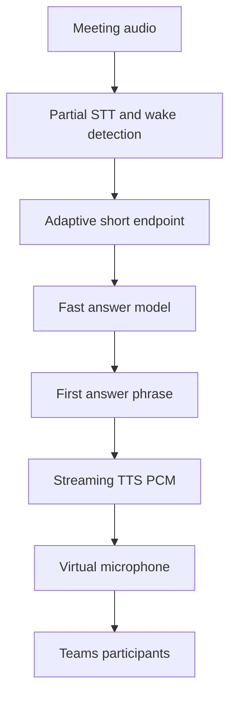

# Virtual Worker — Latency Summary

Latest benchmark: five local question-and-answer trials on 28 October 2026.
This measures the worker's local pipeline, not a complete live Teams call.

## Current latency

- First spoken audio: **7.79 seconds median**, **9.81 seconds P95**
- Complete spoken answer: **17.97 seconds median**, **25.51 seconds P95**

## Pipeline

The measured first-response time is approximately the sum of the stages before
Friday starts speaking. The stages are measured independently, so the numbers
will not add up exactly in every run.

## Where the pipeline is slow

### 1. Capture and silence endpoint — about 2.01 seconds

**What happens:** Friday waits for the person to finish speaking, then waits
for enough silence to decide that the turn has ended.

**Why it is slow:** The worker cannot safely transcribe or answer until it has
a usable segment. Some of this time is simply the time needed for the person
to say the question.

**How to improve it:**

- Test a shorter silence setting, such as 0.3 or 0.5 seconds.
- Use adaptive endpointing instead of one fixed silence value.
- Start partial STT while the person is still speaking.
- Detect the wake name from partial audio.

**Trade-off:** A shorter endpoint can cut off natural pauses or incomplete
sentences.

### 2. Speech-to-text — about 1.65 seconds

**What happens:** faster-whisper transcribes the completed audio segment on the
CPU.

**Why it is slow:** The current path waits for a complete segment and runs a
local model before the answer path starts.

**How to improve it:**

- Test a smaller or faster STT model.
- Use GPU inference if suitable hardware is available.
- Reduce unnecessary audio window size.
- Use streaming or partial transcription.

**Trade-off:** Faster models may make more recognition mistakes. The benchmark
already saw “launch” recognized as “lunch”, so speed must be tested together
with accuracy.

### 3. Context lookup — about 0.002 seconds

**What happens:** The backend loads the current meeting context.

**Why it is not a problem:** It takes only a few milliseconds. Optimizing this
will not meaningfully improve the response time.

**How to improve it:** No immediate work is needed. Caching can still keep the
path predictable as the knowledge base grows.

### 4. Answer model — about 1.96 seconds to the first token

**What happens:** The transcript and context are sent to the remote answer
model, which produces the first part of the answer.

**Why it is slow:** This includes network time, provider queueing, and model
generation. The benchmark does not separate those parts.

**How to improve it:**

- Test a lower-latency model.
- Send a smaller prompt and only the necessary context.
- Keep streaming enabled.
- Test a direct provider connection.
- Use a simple fast path for simple factual questions.

**Trade-off:** Smaller or faster models may give lower-quality answers or handle
STT mistakes less well.

### 5. First text-to-speech audio — about 2.22 seconds

**What happens:** The first answer sentence is sent to TTS and converted into
playable audio.

**Why it is slow:** The current implementation waits for the first sentence
WAV before starting playback. This is the largest delay after STT.

**How to improve it:**

- Stream PCM audio directly into playback.
- Start TTS as soon as the first safe answer phrase arrives.
- Use a faster or direct TTS provider.
- Test a local lightweight voice when speed matters more than voice quality.
- Keep the TTS connection warm when the provider supports it.

**Trade-off:** Streaming audio requires careful buffering, cancellation, and
stop handling. Local or faster voices may sound less natural.

### 6. Full answer playback — about 10.60 seconds after first audio

**What happens:** Friday continues synthesizing and playing the remaining
sentences.

**Why it is slow:** The model may produce a long answer and every sentence
requires audio playback.

**How to improve it:**

- Keep spoken answers short.
- Stream later sentences while the first sentence is playing.
- Stop or cancel the answer immediately when the user interrupts.

**Trade-off:** Shorter answers may omit useful detail.

### 7. Teams and browser delivery — not measured

The benchmark ends when audio starts playing into the virtual microphone. It
does not measure browser capture, Teams transport, server delay, or when a
remote participant hears the answer.

**How to improve it:** Run the same benchmark in a real Teams meeting and add
timestamps around browser capture and remote playback if possible.

## Recommended improvement path

1. **Test endpointing first.** It is low risk and affects every interaction.
2. **Test faster STT.** Measure speed and recognition accuracy together.
3. **Test a faster answer model and smaller prompt.** Keep the current model as
   the quality baseline.
4. **Change TTS to stream audio directly.** This is the most promising larger
   improvement because it removes the wait for a complete WAV.
5. **Keep answers short and interruptible.** This improves completion time and
   makes the worker feel more responsive.
6. **Measure the result on a real Teams call.** The local benchmark does not
   include the final delivery path.

## Improvement options

| Option | Expected first audio | Main benefit | Main cost or risk |
|---|---:|---|---|
| Tune current settings | About 5–7 seconds, hypothesis | Lowest implementation risk | Hosted model and TTS delays remain |
| Optimize streaming path | About 3–5 seconds, hypothesis | Preserves most current quality | Requires streaming and cancellation work |
| Fast local components | About 3–5 seconds, hypothesis | Less network variance | Possible STT, answer, and voice quality loss |
| Realtime audio pipeline | About 1–3 seconds after speech ends, hypothesis | Best conversational response | Highest complexity and provider dependence |
| Immediate acknowledgement | Acknowledgement is near-immediate | Reduces perceived waiting | Does not reduce actual answer time |

These ranges are planning estimates, not measured results. Each option needs an
A/B benchmark before becoming a product target.

## Bottom line

The main gaps are **silence endpointing, CPU STT, remote model startup, and
first-sentence TTS buffering**. Context lookup and local agent reasoning are
not causing the observed delay.

The best practical path is to shorten endpointing, use faster or partial STT,
select a lower-latency answer path, and stream the first TTS audio directly to
the virtual microphone. The largest likely improvement comes from removing the
current wait for a complete TTS WAV.

The current implementation is measurable and working, but the final latency
must be rechecked on a live Teams call before setting an acceptance target.
