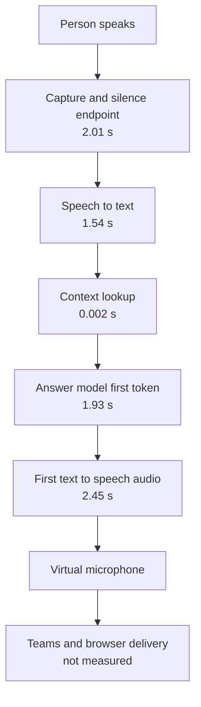
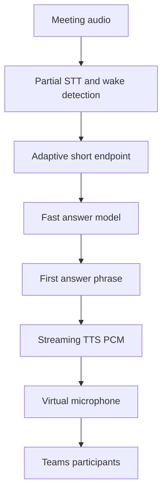

# Virtual Worker — Latency Summary

Latest benchmark: five local question-and-answer trials on 28 October 2026
with expanded stage instrumentation. This measures the worker's local
pipeline, not a complete live Teams call.

## Current latency

- First spoken audio: **7.77 seconds median**, **10.65 seconds maximum**
- Complete spoken answer: **20.32 seconds median**, **26.06 seconds maximum**

These are five-trial results, so the maximum is reported instead of calling it
an independent P95.

## Expanded measurement — 28 October 2026

The worker was measured again with stage boundaries across the agent audio
path and backend context path. The test used the unchanged local-worker
pipeline and
did not include a live meeting participant.

| Stage | Median | Five-trial maximum |
|---|---:|---:|
| Speech to endpoint | 2.01 s | 4.01 s |
| Endpoint to recognized text | 1.54 s | 1.64 s |
| Context request round trip | 1.5 ms | 1.6 ms |
| Backend context processing | 1.1 ms | 1.2 ms |
| Model request to first token | 1.93 s | 2.64 s |
| First TTS audio generation | 2.45 s | 2.97 s |
| Speech to first audio | 7.77 s | 10.65 s |
| Full spoken response | 20.32 s | 26.06 s |

The context lookup and the local agent-to-backend transport are negligible in
this run. The meaningful first-response contributors are endpointing, CPU STT,
model time to first token, and first TTS audio generation. Full-answer time is
also strongly affected by the length of the answer being spoken.

The model timing still combines network transport, OpenRouter routing, provider
queueing, and model generation. It does not identify the internal provider
portion separately. Browser capture, meeting transport, and the time at which a
remote participant hears the response remain unmeasured.

## Network and provider research

From the isolated worker environment on 28 October 2026:

- DNS resolved `openrouter.ai` to two Cloudflare edge addresses.
- Ten ICMP requests averaged **3.9 ms**, with no packet loss.
- Five basic HTTPS requests reached first byte in approximately **85–91 ms**.
- These are edge-connectivity checks, not measurements of a model completion.
  They do not prove that the model provider itself is fast.
- The current worker uses OpenRouter's default routing for
  `openai/gpt-4o-mini`; it does not set provider preferences.
- OpenRouter documents price-oriented default load balancing with uptime
  considerations, plus optional latency sorting and latency preferences. Those
  preferences are not guarantees.
- The public endpoint list for this model currently shows Azure, OpenAI, and
  Azure Sweden Central endpoints. No evidence was found that Singapore, Mumbai,
  or Dubai can simply be selected for this model through the current request.

No provider, region, model, or latency behavior was changed during this
measurement.

## Pipeline

The measured first-response time is approximately the sum of the stages before
Friday starts speaking. The stages are measured independently, so the numbers
will not add up exactly in every run.

## Where the pipeline is slow

### 1. Capture and silence endpoint — about 2.01 seconds

**What happens:** Friday waits for the person to finish speaking, then waits
for enough silence to decide that the turn has ended.

**Why it is slow:** The worker cannot safely transcribe or answer until it has
a usable segment. Some of this time is simply the time needed for the person
to say the question.

**How to improve it:**

- Test a shorter silence setting, such as 0.3 or 0.5 seconds.
- Use adaptive endpointing instead of one fixed silence value.
- Start partial STT while the person is still speaking.
- Detect the wake name from partial audio.

**Trade-off:** A shorter endpoint can cut off natural pauses or incomplete
sentences.

### 2. Speech-to-text — about 1.54 seconds

**What happens:** faster-whisper transcribes the completed audio segment on the
CPU.

**Why it is slow:** The current path waits for a complete segment and runs a
local model before the answer path starts.

**How to improve it:**

- Test a smaller or faster STT model.
- Use GPU inference if suitable hardware is available.
- Reduce unnecessary audio window size.
- Use streaming or partial transcription.

**Trade-off:** Faster models may make more recognition mistakes. The benchmark
already saw “launch” recognized as “lunch”, so speed must be tested together
with accuracy.

### 3. Context lookup — about 0.002 seconds

**What happens:** The backend loads the current meeting context.

**Why it is not a problem:** It takes only a few milliseconds. Optimizing this
will not meaningfully improve the response time.

**How to improve it:** No immediate work is needed. Caching can still keep the
path predictable as the knowledge base grows.

### 4. Answer model — about 1.93 seconds to the first token

**What happens:** The transcript and context are sent to the remote answer
model, which produces the first part of the answer.

**Why it is slow:** This includes network time, provider queueing, and model
generation. The benchmark does not separate those parts.

**How to improve it:**

- Test a lower-latency model.
- Send a smaller prompt and only the necessary context.
- Keep streaming enabled.
- Test a direct provider connection.
- Use a simple fast path for simple factual questions.

**Trade-off:** Smaller or faster models may give lower-quality answers or handle
STT mistakes less well.

### 5. First text-to-speech audio — about 2.45 seconds

**What happens:** The first answer sentence is sent to TTS and converted into
playable audio.

**Why it is slow:** The current implementation waits for the first sentence
WAV before starting playback. This is the largest delay after STT.

**How to improve it:**

- Stream PCM audio directly into playback.
- Start TTS as soon as the first safe answer phrase arrives.
- Use a faster or direct TTS provider.
- Test a local lightweight voice when speed matters more than voice quality.
- Keep the TTS connection warm when the provider supports it.

**Trade-off:** Streaming audio requires careful buffering, cancellation, and
stop handling. Local or faster voices may sound less natural.

### 6. Full answer playback — about 11.90 seconds after first audio

**What happens:** Friday continues synthesizing and playing the remaining
sentences.

**Why it is slow:** The model may produce a long answer and every sentence
requires audio playback.

**How to improve it:**

- Keep spoken answers short.
- Stream later sentences while the first sentence is playing.
- Stop or cancel the answer immediately when the user interrupts.

**Trade-off:** Shorter answers may omit useful detail.

### 7. Teams and browser delivery — not measured

The benchmark ends when audio starts playing into the virtual microphone. It
does not measure browser capture, Teams transport, server delay, or when a
remote participant hears the answer.

**How to improve it:** Run the same benchmark in a real Teams meeting and add
timestamps around browser capture and remote playback if possible.

## Research findings and investigation plan

This section records what the research suggests to test. It does not authorize
any of these changes.

### Endpointing and STT

- The worker uses a local CPU faster-whisper path. The upstream faster-whisper
  documentation describes CPU `int8` as a supported configuration and reports
  lower resource use than full-precision CPU runs, but those published numbers
  are not a benchmark for this machine or this audio workload.
- The worker also performs its own energy-based endpointing before calling STT,
  while STT is invoked with VAD filtering. The two boundaries should be
  measured separately before changing silence settings.
- The next fair comparison is the same captured speech samples with the same
  prompts, comparing endpoint wait, STT duration, and recognition accuracy.
  No model or endpoint setting should be changed as part of the baseline.

Reference: [faster-whisper documentation](https://github.com/SYSTRAN/faster-whisper).

### Model and provider path

- The measured model interval is from the agent's request start to the first
  streamed token. It combines connection, routing, provider queueing, and model
  generation; it is not a provider-only measurement.
- The current request does not set OpenRouter provider preferences. OpenRouter
  documents price-oriented default routing and optional latency sorting or
  latency preferences. Those preferences are not guarantees and should only be
  compared in a controlled experiment.
- The next research record should capture the selected model, routing mode, and
  response timing for each run. It should not change the production routing.

Reference: [OpenRouter provider selection](https://openrouter.ai/docs/guides/routing/provider-selection).

### TTS path

- The TTS HTTP request is streamed, but the current worker collects the audio
  chunks for the first sentence, writes a complete WAV file, and only then
  starts playback. Therefore the network stream is not yet audible streaming.
- The first-TTS measurement is the right boundary for comparing future TTS
  approaches. The comparison must preserve sentence content and voice quality.
- The full-answer measurement is separate because answer length and playback
  duration dominate it.

### Meeting boundary

The live Teams test confirmed that the worker can hear questions and send
responses, and its first-audio timings were consistent with the local runs.
The exact remote-hearing timestamp is still not instrumented, so meeting
transport remains a confirmation gap rather than an identified cause.

Three clean live interactions produced these worker-side timings:

| Question | First worker audio | Full worker playback |
|---|---:|---:|
| What did I just say? | 8.93 s | 22.70 s |
| What is the meeting about? | 8.38 s | 18.08 s |
| Can you repeat the last point? | 9.24 s | 30.68 s |

These measurements end when the worker starts or finishes local playback into
the meeting microphone. They do not include a timestamp from the remote
participant's ears. A few earlier attempts were excluded because STT confused
the wake name or captured echoed/overlong audio.

### Measurement cautions

- Five-trial maxima are useful warning values but are not stable percentile
  estimates.
- A wake-word recognition failure is an interaction/accuracy failure, not a
  latency measurement.
- Echo or long captured segments must be excluded from stage comparisons.
- A latency change should not be called an improvement unless the same prompts,
  configuration, audio boundary, and success criteria are repeated.

## Recommended improvement path

1. **Test endpointing first.** It is low risk and affects every interaction.
2. **Test faster STT.** Measure speed and recognition accuracy together.
3. **Test a faster answer model and smaller prompt.** Keep the current model as
   the quality baseline.
4. **Change TTS to stream audio directly.** This is the most promising larger
   improvement because it removes the wait for a complete WAV.
5. **Keep answers short and interruptible.** This improves completion time and
   makes the worker feel more responsive.
6. **Measure the result on a real Teams call.** The local benchmark does not
   include the final delivery path.

## Improvement options

| Option | Expected first audio | Main benefit | Main cost or risk |
|---|---:|---|---|
| Tune current settings | About 5–7 seconds, hypothesis | Lowest implementation risk | Hosted model and TTS delays remain |
| Optimize streaming path | About 3–5 seconds, hypothesis | Preserves most current quality | Requires streaming and cancellation work |
| Fast local components | About 3–5 seconds, hypothesis | Less network variance | Possible STT, answer, and voice quality loss |
| Realtime audio pipeline | About 1–3 seconds after speech ends, hypothesis | Best conversational response | Highest complexity and provider dependence |
| Immediate acknowledgement | Acknowledgement is near-immediate | Reduces perceived waiting | Does not reduce actual answer time |

These ranges are planning estimates, not measured results. Each option needs an
A/B benchmark before becoming a product target.

## Bottom line

The main gaps are **silence endpointing, CPU STT, remote model startup, and
first-sentence TTS buffering**. Context lookup and local agent reasoning are
not causing the observed delay.

The best practical path is to shorten endpointing, use faster or partial STT,
select a lower-latency answer path, and stream the first TTS audio directly to
the virtual microphone. The largest likely improvement comes from removing the
current wait for a complete TTS WAV.

The current implementation is measurable and working, but the final latency
must be rechecked on a live Teams call before setting an acceptance target.
