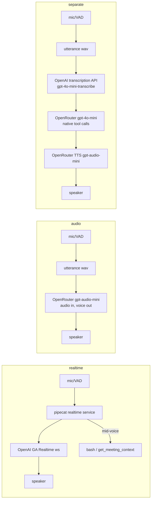

# Three-mode POC — architecture (experiments/pipecat-poc, 3 Nov 2025)

Three conversation modes by pipeline type — `realtime` / `audio` /
`separate` (M8 vocabulary). One launcher, shared tool + accounting layers.

## Files

| File | Role |
|---|---|
| `run.sh` | Launcher: no args → mode menu; unknown mode → error |
| `chat.py` | **realtime**: OpenAI GA Realtime API via pipecat 1.15.0 |
| `chat_audio.py` | **audio** (single-call OpenRouter) + **separate** (STT → think → TTS) |
| `cli_ui.py` | Colored lean output (auto-off non-TTY, `CHAT_FORCE_COLOR=1`) |
| `token_accounting.py` | Token buckets + cost, provider-exact when OpenRouter |
| `stop.sh` | Kill all running instances (graceful SIGINT first) |
| `models.ini` | Per-mode model/preset config (`[realtime]/[audio]/[separate]`) |
| `results/*.json` | Session reports (tokens per turn + totals), written on exit |

## Pipelines



## Shared layers

- **Workdir**: launch dir or `--folder <path>` (`CHAT_WORKDIR`) — bash tool
  runs there, 60 s timeout, 4 KB output cap; registry `run_tool()` in
  `chat_audio.py`, realtime registers via `service.register_function`.
- **Tokens**: `TokenAccount` normalizes OpenRouter / openai-compat /
  OpenAI-GA / pipecat usage shapes into buckets (in/out × text/audio ×
  cached); provider cost when available, else bucket rates + cache
  discount. Turn lines, session line, and `results/*.json`.
- **`You:` display**: local Whisper transcription of the exact mic audio
  (display only); realtime buffers mic frames between VAD stop/start.

## Hard-won constraints (pipecat 1.15.0 / OpenAI GA)

- GA realtime API: `session.type: "realtime"`, nested `audio` config,
  `output_modalities` = `["text"]` XOR `["audio"]` (beta API retired).
- Aggregator consumes response-end frames → report on
  `on_assistant_turn_stopped(aggregator, msg)` (the turns:0 bug).
- `speaker.playing` is derived (queue non-empty OR last feed < 0.3 s),
  never a stored flag.
- Realtime usage MetricsFrame is never pushed by pipecat → shadowed
  `start_llm_usage_metrics` on the service instance.
- Clean exit: SIGINT handlers break the loop so the session report runs;
  `asyncio.run` alone skips `finally` on KeyboardInterrupt.

## Run & test

```bash
cd experiments/pipecat-poc
./run.sh realtime|audio|separate [-d] [--model X] [--folder <path>]
CHAT_TEST_WAV=../realtime-model-poc/fixtures/question.wav ./run.sh <mode>
./stop.sh          # kill all instances, graceful first
```
Keys in git-ignored `.env`: `OPENROUTER_API_KEY`, `OPENAI_API_KEY`.
Python 3.11, UV only, foreground only (no background processes).